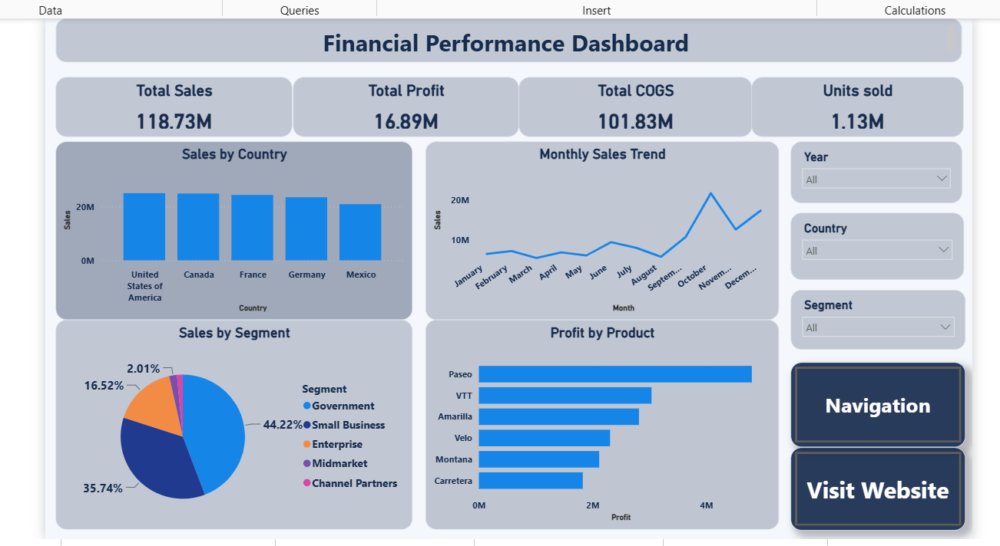

# Financial Performance Dashboard | Power BI

# Project Overview
This project presents an interactive financial performance dashboard built using Microsoft Power BI. It helps analyze sales, profit, cost of goods sold, units sold, and performance across products, countries, and business segments.

# Key Performance Indicators (KPIs)
- **Total Sales:** 118.73M
- **Total Profit:** 16.89M
- **Total COGS:** 101.83M
- **Total Units Sold:** 1.13M

# Dashboard Features
- Sales analysis by business segment
- Monthly sales trend analysis
- Country-wise sales comparison
- Product-wise profit analysis
- Interactive filters for Year, Country, and Segment
- Additional pages for financial metrics, regional profit analysis, and sales details

# Tools & Technologies
- Microsoft Power BI
- Power Query for data cleaning and transformation
- Data visualization and KPI reporting

# Dashboard Preview

# Project Files
- `Financial_Performance_Dashboard.pbix` — Interactive Power BI report
- `dashboard-preview.png` — Dashboard screenshot

# How to Use
1. Download the `.pbix` file from this repository.
2. Open it using Power BI Desktop.
3. Use the slicers to explore financial performance across different categories.

# Project Objective
To develop practical skills in data cleaning, business intelligence, KPI analysis, and interactive dashboard development.
